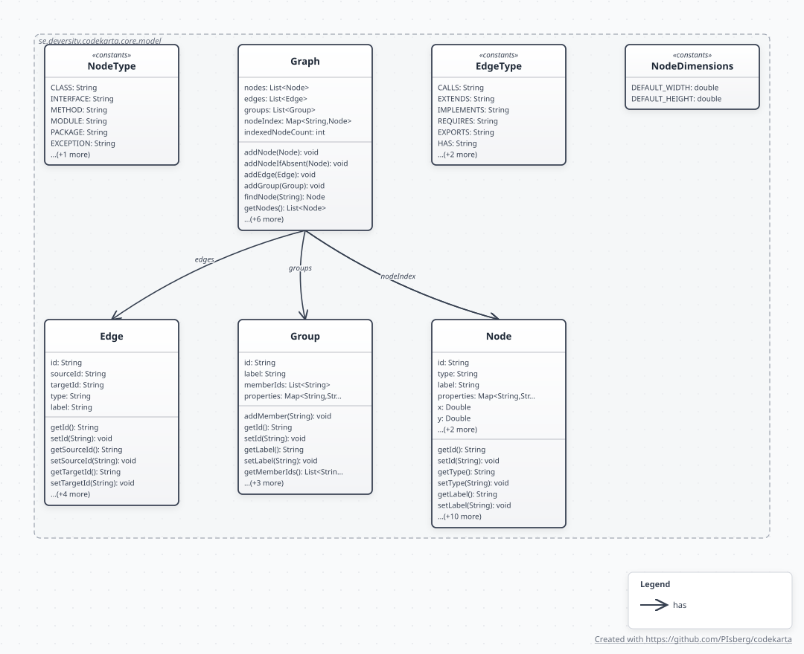
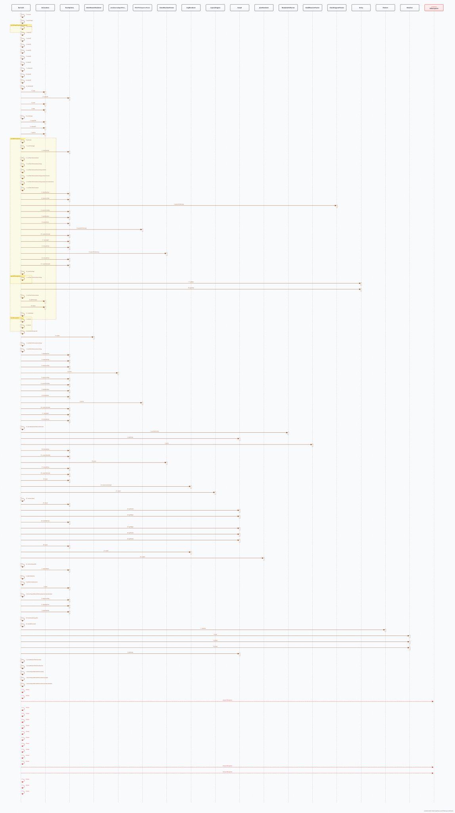
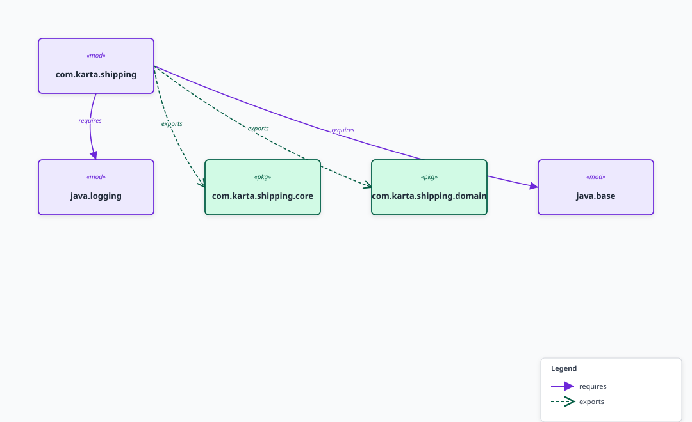

# Architecture

code-karta is a compiler-style Java architecture mapping pipeline. Each stage does one job and exchanges only the shared `Graph` intermediate representation from `code-karta-core`.

```text
Java source
   |
   v
code-karta-input
   JavaParser-based source analysis
   Graph with nodes, edges, groups
   |
   v
code-karta-layout
   coordinate assignment
   same Graph with x, y, width, height
   |
   v
code-karta-render
   SVG generation
   |
   v
code-karta-cli
   command-line orchestration and file output
```

The dependency rule is strict: lower-level modules do not depend on higher-level modules, and sibling tiers do not call each other. `input` does not import `layout` or `render`; `layout` does not import `render`; `render` does not import parsers. The CLI is the composition layer.

## Modules

| Module | Responsibility | Depends on |
|---|---|---|
| `code-karta-core` | Graph IR model: `Graph`, `Node`, `Edge`, `Group`, node/edge enums, dimensions | none |
| `code-karta-input` | Parse Java source into a graph | `core`, JavaParser |
| `code-karta-layout` | Assign node coordinates and sizes | `core`, optional ELK |
| `code-karta-render` | Convert a laid-out graph to SVG | `core` |
| `code-karta-cli` | Parse flags, select parser/layout mode, write SVG files | all modules |

## Core IR

`code-karta-core` is the shared contract between every tier. It intentionally contains data only.

| Type | Purpose |
|---|---|
| `Graph` | Container for `nodes`, `edges`, and `groups`; includes helpers such as `addNodeIfAbsent` and `findNode`. |
| `Node` | A vertex with `id`, `type`, `label`, optional layout fields, and optional `properties`. |
| `Edge` | Directed relationship with `id`, `sourceId`, `targetId`, `type`, and optional `label`. |
| `Group` | Named cluster of node IDs, used for module/package boundaries and try/catch regions. A try/catch group sets `properties.owner` to the METHOD holding the `try` block (`Group.OWNER_PROPERTY`). |
| `NodeDimensions` | Central default dimensions used by layout/render code. |

Jackson omits null fields with `@JsonInclude(NON_NULL)`, so raw parser output stays compact until layout coordinates are assigned.

Example graph:

```json
{
  "nodes": [
    { "id": "shipping.Cargo", "type": "CLASS", "label": "Cargo", "x": 20, "y": 150, "width": 150, "height": 50 },
    { "id": "shipping.ShippingUnit", "type": "INTERFACE", "label": "ShippingUnit", "x": 220, "y": 20, "width": 150, "height": 50 }
  ],
  "edges": [
    { "id": "shipping.Cargo-implements-shipping.ShippingUnit", "sourceId": "shipping.Cargo", "targetId": "shipping.ShippingUnit", "type": "IMPLEMENTS" }
  ],
  "groups": [
    { "id": "package-shipping", "label": "shipping", "memberIds": ["shipping.Cargo", "shipping.ShippingUnit"] }
  ]
}
```

In a class diagram a type's node `id` is its qualified name (`shipping.Cargo`; just `Cargo` in the
default package) and its `label` is the simple name, so two `Config` classes in different
packages stay two nodes. A field or supertype reference resolves the way `javac` would: a
qualified name, then a single-type import, then the file's own package, then on-demand imports.
A simple name none of those settle resolves only if exactly one type in the input carries it;
otherwise no edge is drawn rather than a guessed one.

## Input Tier

`code-karta-input` uses JavaParser to analyze source files and populate the IR. `JavaSourceInputParser` is the facade used by the CLI and by most library users.

| Parser | Input | Nodes | Edges and groups |
|---|---|---|---|
| `ModuleInfoParser` | `module-info.java` | `MODULE`, `PACKAGE` | `REQUIRES`, `EXPORTS` |
| `ClassDiagramParser` | directory | `CLASS`, `INTERFACE` | `EXTENDS`, `IMPLEMENTS`, `HAS` edges, and `Group` (package clusters) |
| `ExceptionFlowParser` | one `.java` file | `CLASS`, `METHOD`, `EXCEPTION` | `CALLS`, `EXCEPTION_PROPAGATION`, try/catch `Group`s |
| `CallSequenceParser` | one `.java` file | `CLASS`, `METHOD` | ordered `CALLS` |
| `MultiFileSequenceParser` | source directory | `CLASS`, `METHOD` | ordered `CALLS`, cross-file callee IDs when symbol solving succeeds |
| `StateMachineParser` | file or directory plus `--state-machine` | `STATE` | `TRANSITION` |

The three sequence parsers share `METHOD` ids through `MethodIds`: `Owner.name`, or `Owner.name(String,int)` when the owner declares that name more than once; a constructor is `Owner.new` (label `new`, a keyword so no method can clash), suffixed the same way when there are several. A call is a method call, a method reference (`this::convert`, `processor::handle`, `Type::new`), or `new Type(...)` of a project type (declared in the same file for the single-file parsers, anywhere in the input for `MultiFileSequenceParser`). Parameter types are reduced to simple raw names so the id holds no dot after the owner's, and the label stays the plain name. Each type contributes only the methods and constructors it declares itself; a call made inside an anonymous class or a lambda counts for the method that declares it.

The single-file parsers have no symbol solver, so they type a call's receiver from declarations: a field, record component, parameter, local, catch or for-each variable gives its declared raw type, and `var` takes the type of `new T(...)` or of the local method it is assigned from. `matcher.find()` is then a call on `Matcher`, which the stdlib filter drops, and every `Repo` variable lands on one `Repo` lifeline. A receiver whose type cannot be read is drawn by its name, as before.

Dispatch rules:

```text
module-info.java              -> ModuleInfoParser
directory                     -> ClassDiagramParser
single .java file             -> ExceptionFlowParser
single .java file + sequence  -> CallSequenceParser
directory + sequence          -> MultiFileSequenceParser, selected by KartaCli
file/directory + state        -> StateMachineParser, selected by KartaCli
```

The parsers are fault tolerant. Parse failures are logged and produce partial or empty graphs rather than crashing the pipeline.

Class diagrams filter obvious JDK types and primitives so associations stay focused on project types. Class and interface nodes can include `fields` and `methods` entries in `Node.properties`; the SVG renderer uses those properties for UML compartments.

### Diagram Scaling Features
To support clean diagramming in large codebases, several architectural scaling constraints are supported:
*   **Package-Based Visual Clustering:** `ClassDiagramParser` automatically extracts package declarations and groups class nodes into nested `Group` blocks. These clusters are cleanly rendered by the compound routing engine, avoiding monolithic flat "hairballs".
*   **Configurable Filtering:** Dynamic class and method filtering is supported via `FilterMatcher`. Users can exclude unwanted frameworks, utility classes, or test classes using wildcard patterns (e.g. `*Test`, `se.deversity.codekarta.util.*`, `Order*Service`), tested against both simple and qualified names. `*` may appear anywhere and is matched without regular expressions, so a pattern cannot make matching backtrack. Every parser takes the patterns, including `StateMachineParser` (enums and states) and the two module parsers.
*   **Sequence Depth Limiting:** `MultiFileSequenceParser` supports depth-limited stitching. It performs a post-processing BFS from sequence entry points and prunes any nodes/edges exceeding a user-defined `--max-depth`. An entry point is a method no *other* method calls, so a recursive method still starts its tree; a cycle nothing outside calls starts from its first method in graph order. `SequenceDiagramRenderer` orders messages from the same entry points, and the two are kept in step with `@AIKeepInSync`.

State-machine parsing targets enum-backed workflow code. Enum constants become `STATE` nodes. Switch entries, state assignments, returns/yields, switch-expression arrow rules (`case A -> B`), and explicit `transition(from, to, event)` calls become `TRANSITION` edges. A directory is read in two passes, every enum first and then every file's transitions against all of them; state variables are recognised by declared enum type, and both ends of a transition must belong to one enum.

## Layout Tier

`LayoutEngine` is the layout contract:

```java
Graph layout(Graph graph);
```

Implementations mutate the same `Graph` instance and return it for chaining. They should set `x`, `y`, `width`, and `height` on every positioned node. The renderer skips nodes with missing coordinates, which lets partial graphs fail softly.

| Engine | Use case |
|---|---|
| `SimpleLayoutEngine` | Default pure-Java layout. Uses root discovery plus breadth-first depth levels and a row/column grid. Predictable and dependency-light. |
| `ElkLayoutEngine` | Large or dense graphs. Uses Eclipse Layout Kernel layered layout for crossing reduction and routed edges. Falls back to simple layout if ELK fails. |

Both engines size nodes for what the renderer will draw. `SvgRenderer` draws a class or interface with member compartments as tall as its members need, whatever height layout assigned, so each engine reserves `RenderedSize.estimateHeight(node)` (package-private in `code-karta-layout`): the compartment height for a node with `fields` or `methods`, otherwise `NodeDimensions.DEFAULT_HEIGHT`. `SimpleLayoutEngine` uses it as the row pitch, and `ElkLayoutEngine` gives it to ELK as the node height. Layout may not reference render, so the formula mirrors `SvgRenderer.computeCompartmentHeight`; `@AIKeepInSync` names the pair, and `RenderedOverlapTest` lays out the same wide classes with both engines and fails if any two boxes overlap at their rendered height.

`ElkLayoutEngine` sets `DIRECTION = DOWN` on the root and on every compound (package) node. ELK does not inherit the option, so without the second setting the members of a package were laid out in one row.

CLI selection:

```bash
--layout simple
--layout elk
```

## Render Tier

`SvgRenderer` converts a laid-out `Graph` into a self-contained SVG string:

```java
String svg = new SvgRenderer().render(graph);
String themed = new SvgRenderer().render(graph, cssOverride);
```

Rendering behavior:

| Graph content | Renderer behavior |
|---|---|
| Class/module graph | UML-like boxes, curved edges, groups, arrow markers, legend |
| `METHOD` nodes plus integer-labelled `CALLS` edges | Delegates to `SequenceDiagramRenderer` |
| `STATE` nodes plus `TRANSITION` edges | Rounded state nodes with labelled transition arrows |
| Node `properties.fields` or `properties.methods` | Renders UML compartments |
| `Group` entries | Renders bounding regions |
| Missing node coordinates | Skips those nodes safely |

`SequenceDiagramRenderer` derives participant lanes from method node IDs, renders ordered messages, self-calls, activation bars, exception propagation arrows, and try/catch frames when present. A frame encloses the calls its `owner` method makes to the group's members; a group without an owner falls back to every call to them.

### Svg Interactive Capabilities
To support the single-page diagram viewer (`viewer.html`), the rendered SVG embeds structured markup:
*   **Stable CSS Classes:** Elements are styled using `.node-rect`, `.edge-line`, `.group-rect`, and other standard class names.
*   **Edge Metadata:** Rendered edges carry a `data-type` attribute (e.g. `data-type="CALLS"`, `data-type="EXTENDS"`) corresponding to the `EdgeType` or relationship enum. The diagram viewer's sidebar toggles query these selectors to hide or show relationships dynamically.
*   **Node Text & Search:** Nodes contain readable labels that are queried by the viewer's real-time search engine. When a search query is active, non-matching nodes are dimmed to $15\%$ opacity, and matching nodes are highlighted with a glowing blue border.

All user-visible text is XML escaped. SVG elements use stable CSS class names, including `.node-rect`, `.node-label`, `.edge-line`, and `.group-rect`.

## CLI

`KartaCli` wires the three tiers together:

```text
parse flags
create output directory
parse input path into Graph
layout Graph
render SVG
derive deterministic filename
write output file
```

Public API:

```java
Path run(Path inputPath, Path outputDir) throws IOException
Path run(Path inputPath, Path outputDir, boolean sequenceOnly) throws IOException
Path run(Path inputPath, Path outputDir, boolean sequenceOnly, String layout) throws IOException
Path run(Path inputPath, Path outputDir, boolean sequenceOnly, String layout, boolean stateMachine) throws IOException
```

Output naming:

| Input | Output |
|---|---|
| `module-info.java` | `module-diagram.svg` |
| directory | `class-diagram.svg` |
| directory plus `--sequence-only` | `sequence-diagram.svg` |
| `.java` file | `<lowercase-classname>-sequence-diagram.svg` |
| directory plus `--state-machine` | `state-machine-diagram.svg` |
| `.java` file plus `--state-machine` | `<lowercase-classname>-state-machine-diagram.svg` |

## Example Diagrams

The repository keeps generated examples in `docs/diagrams/` and `example-shipping-system/diagrams/`.







Regeneration:

```bash
mvn verify -DskipTests
./gradlew :code-karta-cli:generateDiagrams
```

Skip generation:

```bash
mvn verify -DskipTests -DskipDiagrams=true
./gradlew :code-karta-cli:generateDiagrams -PskipDiagrams
```

## Extension Points

| Goal | Approach |
|---|---|
| Add a diagram type | Add or extend an input parser that emits the existing `Graph` IR. |
| Add a layout algorithm | Implement `LayoutEngine`; keep dependencies out of input/render modules. |
| Add an output format | Create a renderer that depends only on `code-karta-core`. |
| Add a language | Implement a parser that maps that language into `Node`, `Edge`, and `Group`. |
| Theme SVG output | Pass a CSS override to `SvgRenderer.render(graph, css)`. |
| Add framework-aware grouping | Extend input parsers to emit `Group` entries from annotations or package rules. |

When extending the project, preserve the IR boundary. New analysis belongs in input, spatial decisions belong in layout, visual decisions belong in render, and orchestration belongs in cli.
